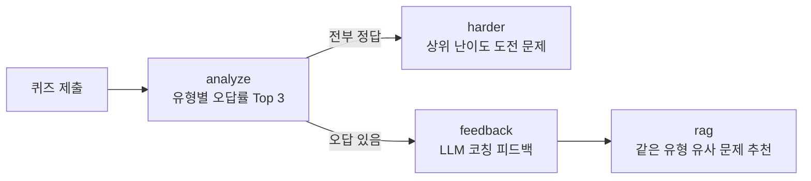
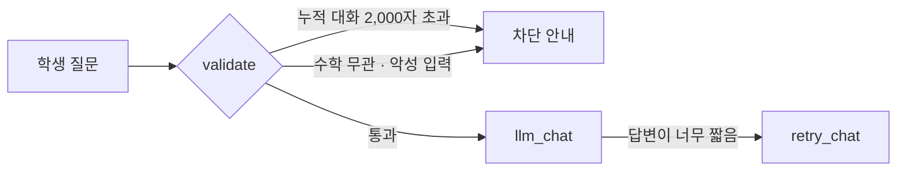

# WIDN Math · AI Math Coach

중학교 2학년 1학기 수학 문제를 풀면 **유형별 약점**을 찾아 보완 문제를 추천하고, 막히는 문제는 **풀이 챗봇**이 함께 풀어주는 학습 서비스입니다.

> SSAFY 15기 1학기 프로젝트 · 2026.05 – 2026.06 · 2인 팀

<br>

## 주요 기능

- **퀴즈 풀기** — 대단원·중단원·문항 수를 골라 출제, 수식은 KaTeX로 렌더링
- **약점 분석** — 채점 후 유형별 오답률을 계산해 취약 유형 Top 3와 AI 코칭 피드백 제공
- **보완 문제 추천** — 취약 유형마다 같은 유형의 비슷한 문제를 `하` 2문제 + `중` 1문제로 추천 (ChromaDB 유사도 검색)
- **도전 문제** — 전부 맞히면 같은 단원에서 한 단계 어려운 문제 추천
- **복습과 마스터 기록** — 오답 이어풀기, 유형별 복습 전후 정답률 기록
- **풀이 챗봇** — 문제별 질문에 답하되, 수학과 무관하거나 악성인 질문과 지나치게 길어진 대화는 차단
- **커뮤니티 · 대시보드** — 문제별 토론 게시판, 학습 히스토리와 연속 학습일

<br>

## AI 코칭 흐름

퀴즈를 제출하면 LangGraph로 구성한 코칭 그래프가 결과에 따라 분기합니다.



- 추천 문제는 **반드시 같은 유형 안에서만** 고릅니다. 원하는 난이도가 부족하면 같은 유형의 다른 난이도로 채우고, 다른 유형 문제로는 채우지 않습니다.
- 이미 푼 문제와 앞 단계에서 추천한 문제는 제외합니다.

풀이 챗봇은 질문을 LLM에 넘기기 전에 먼저 걸러냅니다.



- 대화 길이 초과는 API를 호출하지 않고 바로 차단합니다.
- 가드레일 판단은 JSON(`block`, `reason`)으로만 받아 분기에 사용합니다.

<br>

## 데이터

| 항목 | 내용 |
|---|---|
| 범위 | 중학교 2학년 1학기 수학 · 1,770문항 (객관식 1,463 · 주관식 307) |
| 분류 | 대단원 3개 · 유형 64개 · 난이도 상/중/하 |
| 정제 | 단원·유형 분류, 객관식 보기 복구, 정답 형식 정규화, 문제 이미지 영역 분리 |
| 출처 | [AI-Hub](https://www.aihub.or.kr) 수학 교과 문제 데이터에서 중2 1학기 범위만 추려 사용 |

정제 과정은 Django 관리 명령(`import_problems`, `normalize_quiz_answers`, `dedupe_problem_assets` 등)과 [`apply_data_recovery.sh`](apply_data_recovery.sh)로 재현할 수 있습니다.

<br>

## 기술 스택

| 분야 | 기술 |
|---|---|
| Backend | Python · Django 4.2 · Django REST Framework · SQLite |
| AI | LangGraph · OpenAI API (`gpt-4o-mini`, `text-embedding-3-small`) · ChromaDB |
| Frontend | Vue 3 · Pinia · Vue Router · Vite · KaTeX |

<br>

## 역할

| 이름 | 담당 |
|---|---|
| 송수빈 ([suvinn](https://github.com/suvinn)) | 백엔드 · 데이터 · AI — 데이터 정제와 유형 분류, DB 설계, REST API, LangGraph 코칭·챗봇 파이프라인, RAG 추천 |
| 조유진 ([olaflove](https://github.com/olaflove)) | 프론트엔드 — Vue 화면 설계와 구현, UI 개선 |

<br>

## 실행 방법

```bash
# 1. 백엔드
pip install -r requirements.txt
# 프로젝트 루트에 .env 작성: SECRET_KEY, GMS_KEY
cd app
python manage.py migrate
python manage.py import_problems ../data/merged_problems_fixed.csv
python manage.py build_vector_db      # 문제 임베딩 → ChromaDB
python manage.py runserver            # http://localhost:8000

# 2. 프론트엔드
cd front
npm install
npm run dev
```

- `GMS_KEY`는 SSAFY GMS(OpenAI 프록시) 키입니다. 다른 환경에서는 `app/config/settings.py`의 `GMS_URL`을 OpenAI 엔드포인트로 바꿔 사용하세요.
- 문제 이미지(`media/`)는 레포에 포함되어 있지 않습니다.
